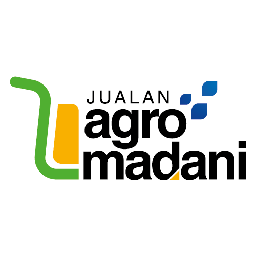

# 🇲🇾 JAM Loyalty Card (Sistem Kad Kesetiaan Jualan Agro MADANI)

Prototaip sistem kad kesetiaan dan agihan subsidi digital berasaskan mata bagi program **Jualan Agro MADANI (JAM)**.



---

## ✨ Ciri-Ciri Utama (Key Features)

1. **Kadar Telus (1 Mata = 1 Sen / RM 0.01)**
   - Setiap mata bersamaan RM 0.01 (Cth: 1,500 mata = RM 15.00). Mudah difahami oleh rakyat dan peniaga tanpa formula rumit.

2. **Reka Bentuk Kad Mewah (*Loyalty Card*)**
   - Diinspirasikan oleh tema *soft glassmorphism* moden dan rona warna rasmi Jualan Agro MADANI (Hijau, Kuning Emas, dan Biru Diraja).
   - Tipografi Apple San Francisco (`SF Pro Display`) dengan sentuhan tajuk elegan berhuruf condong ***Loyalty Card***.
   - Menggunakan imej sebenar produk segar tempatan (Ayam Segar, Telur Gred A, Buah-buahan Tempatan & Sayur Kampung) tanpa ikon kartun percuma.

3. **Imbasan Kod QR Kamera Langsung (Live Camera Scanner)**
   - Pembeli boleh terus membuka kamera peranti telefon pintar (`html5-qrcode`) untuk mengimbas kod QR di meja gerai peniaga.
   - Pilihan imbasan manual dan pemilihan pantas produk turut disertakan untuk kemudahan demonstrasi.

4. **Pengurusan Had Tempoh Mata Kad (Points Expiry Management)**
   - Penganjur (Admin) boleh menetapkan tarikh luput mata (contohnya sehingga jam 6:00 petang hari pasar atau akhir bulan).
   - Mata yang tidak digunakan boleh tamat tempoh automatik (*expired*) dan dana subsidi yang tidak ditebus dipulangkan semula ke peruntukan utama JAM.
   - Penunjuk had masa dipaparkan secara langsung pada kad pembeli dan panel penyata sejarah aktiviti.

5. **Terminal Standee Peniaga Gerai & Chime Audio**
   - Paparan kod QR dinamik gerai beresolusi tinggi untuk diletakkan di kaunter gerai.
   - Dilengkapi sistem audio *cashier chime* apabila menerima transaksi potongan mata daripada pembeli.
   - Modul penghantaran tuntutan bayaran balik tunai/DuitNow kepada penganjur.

6. **Simulasi Serentak (Split View)**
   - Membolehkan pembentangan langsung aliran transaksi sebelah-menyebelah (Skrin Telefon Pembeli di sebelah kiri dan Terminal Gerai Peniaga di sebelah kanan).

---

## 🛠️ Teknologi & Pakej (Tech Stack)

- **Frontend**: [React 19](https://react.dev/), [TypeScript](https://www.typescriptlang.org/)
- **Bundler**: [Vite](https://vite.dev/)
- **Styling**: [Tailwind CSS v4](https://tailwindcss.com/) dengan Glassmorphism & Wave Gradients
- **QR Engine**: [html5-qrcode](https://github.com/mebjas/html5-qrcode), [qrcode.react](https://github.com/zpao/qrcode.react)
- **Icons & Effects**: [Lucide React](https://lucide.dev/), [canvas-confetti](https://github.com/catdad/canvas-confetti)
- **Audio**: Web Audio API Synthesizer (Cashier Chime)

---

## 🚀 Panduan Menjalankan Sistem (Getting Started)

### 1. Pasang Keperluan (Install Dependencies)
```bash
npm install
```

### 2. Mulakan Pelayan Pembangunan (Start Dev Server)
```bash
npm run dev
```
Buka pelayar web di `http://localhost:5173/`.

### 3. Bina untuk Pengeluaran (Production Build)
```bash
npm run build
```

---

## 📄 Hak Cipta & Lesen
Disediakan khusus untuk inisiatif **Jualan Agro MADANI**.
